# Guía de Incentivos de campaña

Cómo ofrecer recompensas a quienes donan («dona al menos X y recibe Y»): el catálogo de incentivos, los cupones, las donaciones como regalo para otra persona, la entrega de las recompensas y lo que ve el donante en el widget.

*Módulo: Campañas · Ubicación: consola > Campañas > detalle de la campaña > pestaña Incentivos · Audiencia: equipos de fundraising y comunicaciones, Customer Success, equipos técnicos que insertan el widget*

> Las capturas son de un entorno de prueba con datos ficticios.

---

## Qué es

**Incentivos convierte una campaña de donación en una campaña con recompensas.** Cada incentivo tiene un monto mínimo de donación; cuando el donante llega a ese mínimo, el incentivo se desbloquea y puede elegirlo. La recompensa se reserva antes de cobrar, se asigna solo cuando el pago se confirma y se entrega de forma automática o desde el panel de entregas.

Incluye:

- **Catálogo** de hasta 12 incentivos por campaña, físicos o digitales, con stock.
- **Cupones** que bajan el mínimo para desbloquear incentivos, sin cambiar lo que se cobra.
- **Regalo para terceros:** donar en nombre de otra persona, con tarjeta y mensaje.
- **Panel de entregas** con el estado de cada recompensa.
- **Entrega automática** con flujos de trabajo.
- **Tipo de donación** en transacciones y exportaciones, para distinguir las donaciones con incentivo.

Funciona en la moneda de cada organización.

## Antes de empezar

- **Solo en widgets de donación.** Los widgets con meta «Producto» no muestran incentivos.
- **Donación única y mensual.** En la mensual, la recompensa se asigna una sola vez, con el primer cargo confirmado.
- **Un widget, una campaña.** Un widget solo puede mostrar los incentivos de una campaña a la vez.
- **Ten listas las fotos** de los incentivos (formato cuadrado) y, para los físicos, el stock disponible.

---

# Cómo lo vive el donante

## Cada monto desbloquea algo

Cada incentivo tiene un **mínimo por frecuencia** (por ejemplo, R$ 89 en donación única y R$ 40 al mes). Los incentivos se acumulan: con un monto mayor, el donante puede elegir entre todos los desbloqueados, y el widget preselecciona el más alto. Una barra muestra cuánto falta para el siguiente.

| Donación única | Donación mensual |
|---|---|
| 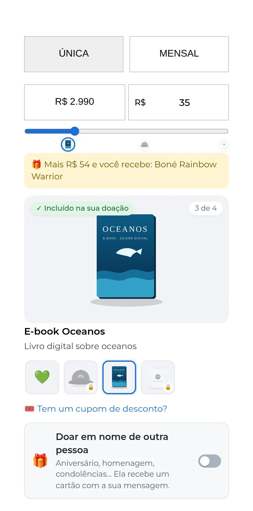 | 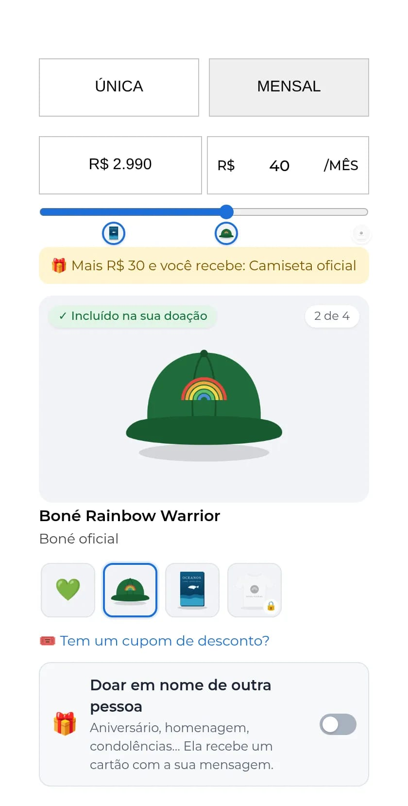 |
| Con R$ 35 se preselecciona el incentivo desbloqueado y la barra indica cuánto falta para el siguiente. | Los mínimos cambian con la frecuencia y la barra se recalcula. |

Si dos incentivos tienen el mismo mínimo, gana el orden del catálogo.

## Bloqueado y desbloqueado

Los incentivos que todavía no alcanza aparecen con un candado y el aviso de cuánto falta. Al tocar uno bloqueado, el monto sube justo a su mínimo.

| Antes | Después |
|---|---|
| 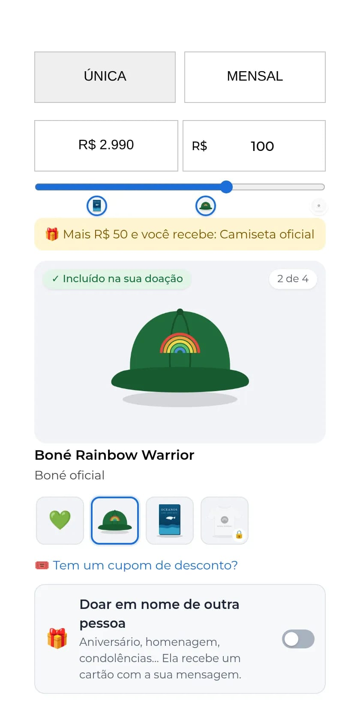 | 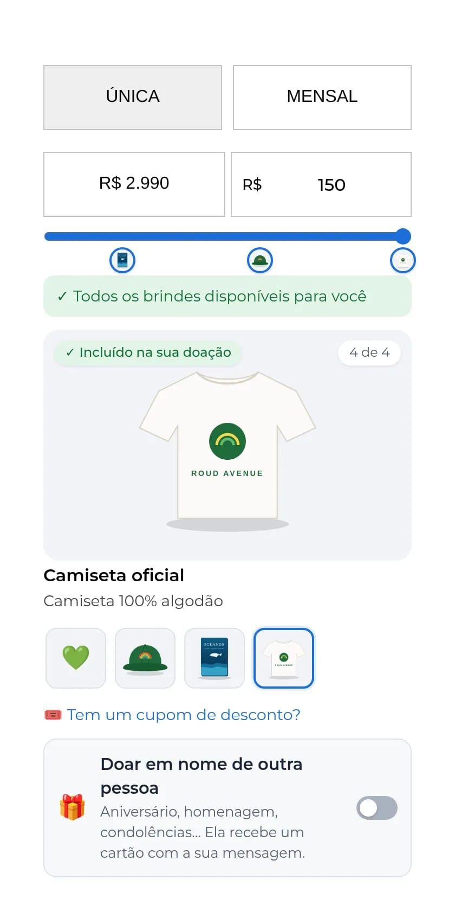 |
| Con R$ 100 el gorro está incluido; la camiseta aparece con candado: «Mais R$ 50 e você recebe». | Al tocar la camiseta el monto sube a R$ 150: todos los incentivos desbloqueados. |

- Un incentivo físico **agotado se oculta**, para que nadie elija algo que no se puede entregar.
- El campo «Otro valor» llega hasta 20 veces el mínimo más alto de la frecuencia (o el máximo del widget, si es menor).

---

# Cupones

**Un cupón baja el mínimo para desbloquear incentivos. Nunca cambia el cobro:** el donante sigue pagando el monto que elige.

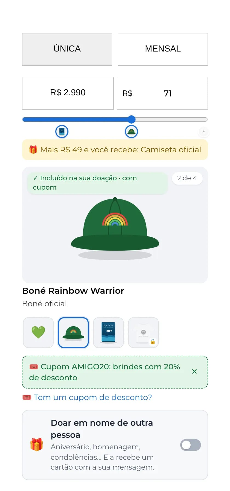

- **Cómo llega:** en el enlace de la página con `?cupom=CODIGO`, o con el atributo `coupon` del formulario insertado. También se puede escribir en el widget.
- **Cálculo:** el mínimo con descuento se redondea al entero más cercano. Por ejemplo, un mínimo de R$ 89 con un cupón de 20 % queda en R$ 71.
- **Usos:** se cuentan solo cuando el pago se confirma.
- **Configuración:** código, porcentaje de descuento (de 1 a 90 %), vencimiento, usos máximos, frecuencia y a qué incentivos aplica. El código no se puede cambiar después del primer uso.
- **Rechazos:** cualquier cupón inválido, vencido o agotado muestra el mismo mensaje al donante.

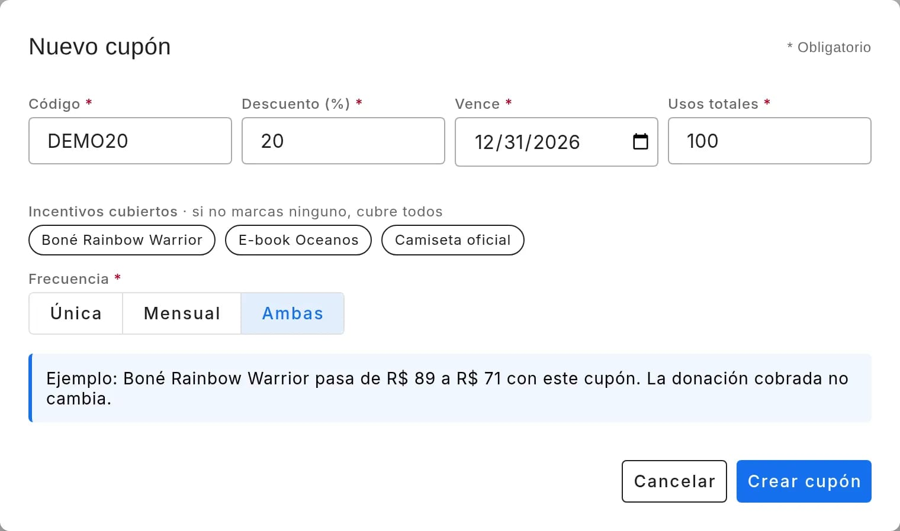

El formulario incluye un ejemplo en vivo de cómo cambia el mínimo de cada incentivo con el descuento.

---

# Regalo para terceros

Con un incentivo elegido aparece la opción **«Doar em nome de outra pessoa»** (donar en nombre de otra persona). Al activarla, el widget pasa a tres pasos: la donación, los datos de quien recibe el regalo y los datos de quien dona.

| Paso 1: activar | Paso 2: quien recibe |
|---|---|
| 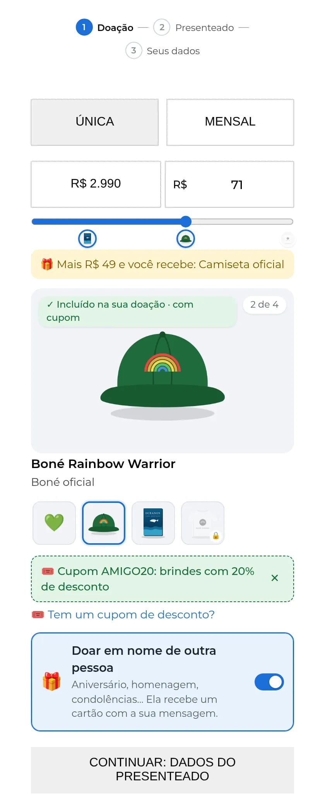 | 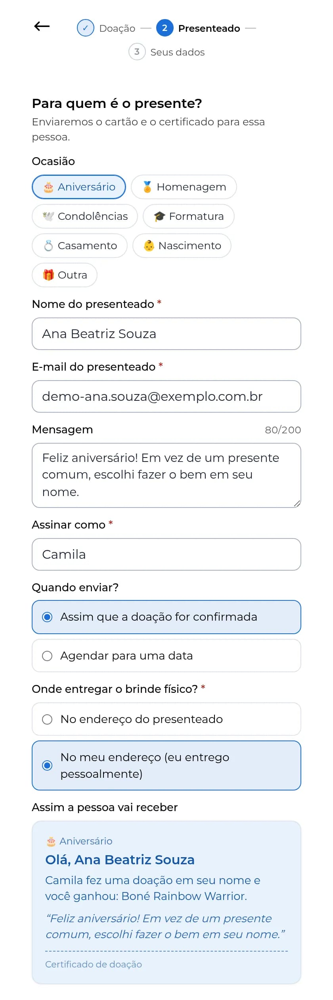 |
| El interruptor abre el flujo de regalo. | Ocasión, mensaje sugerido editable, datos de quien recibe, cuándo enviar y la vista previa de la tarjeta. |

- **La tarjeta cambia con la ocasión** (cumpleaños, homenaje, condolencias…), y el donante ve exactamente lo que llegará.
- **Incentivo físico:** si se entrega en casa de quien recibe, se pide su dirección.
- **Paso 3:** resumen del regalo con opción de editar antes de pagar.

| Tarjeta de condolencias | Dirección de entrega | Resumen |
|---|---|---|
| 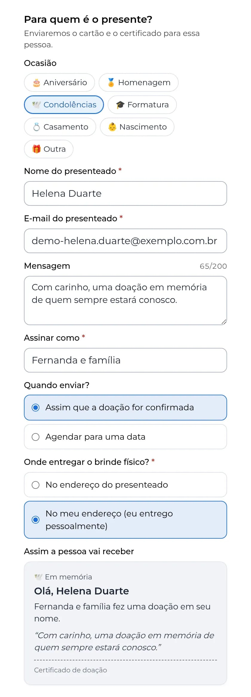 | 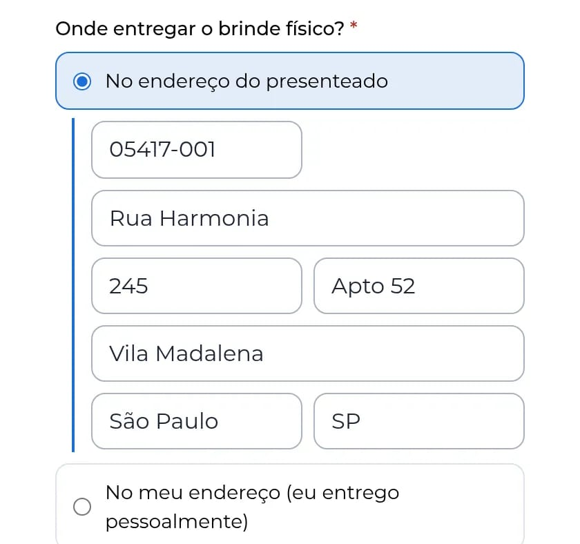 | 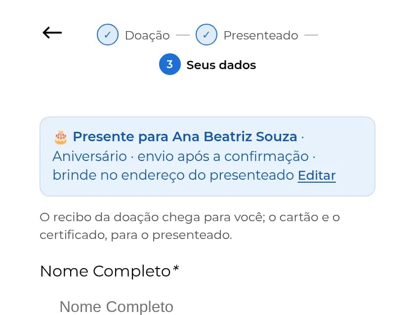 |

**Privacidad de quien recibe el regalo:**

- Quien recibe se agrega a los contactos de la organización solo con el canal de correo, y con un origen propio que lo distingue de los donantes.
- Si ya era contacto, conserva su consentimiento y su origen.
- Si la donación no se paga, los datos de quien recibe y la dirección se borran a los 7 días.

---

# En la moneda de cada organización

Los mínimos se definen en la moneda de la organización y el widget los muestra con su símbolo, sin ambigüedad (R$, US$, CLP$, COP$, MX$, ARS$…). Las monedas sin decimales, como el peso chileno, se muestran sin decimales.

| BRL | USD | CLP |
|---|---|---|
|  | 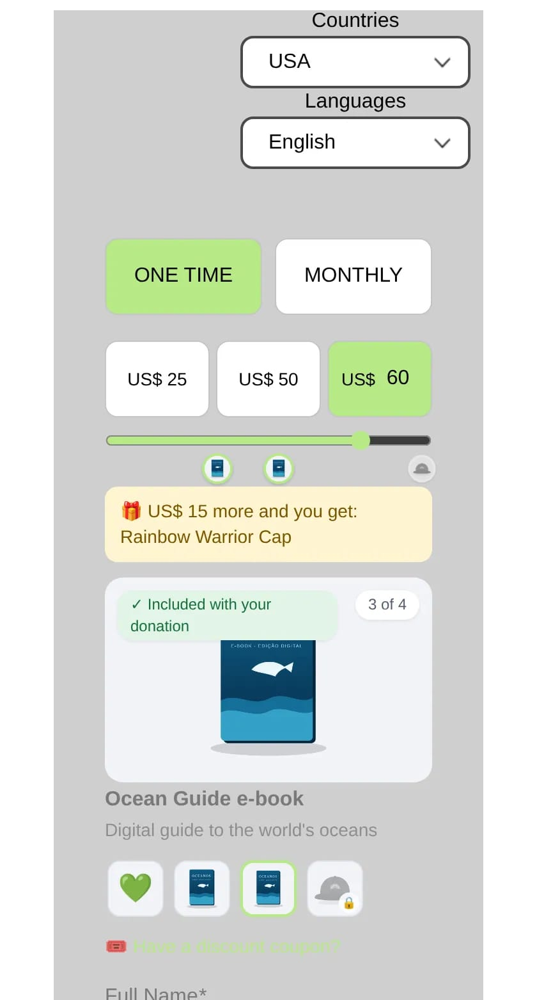 | 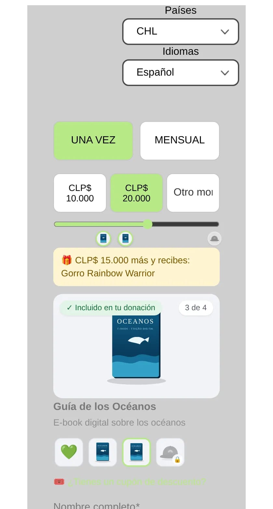 |

- Si el donante cambia a otra moneda en el widget, se ocultan los incentivos, el regalo y el cupón, y la donación sigue sin incentivo.
- La búsqueda de dirección por código postal (CEP) solo funciona en Brasil; en otros países se usan los campos de dirección del widget.

---

# Configuración en la consola

Todo se configura por campaña, en la pestaña **Incentivos**. No hace falta editar el widget.

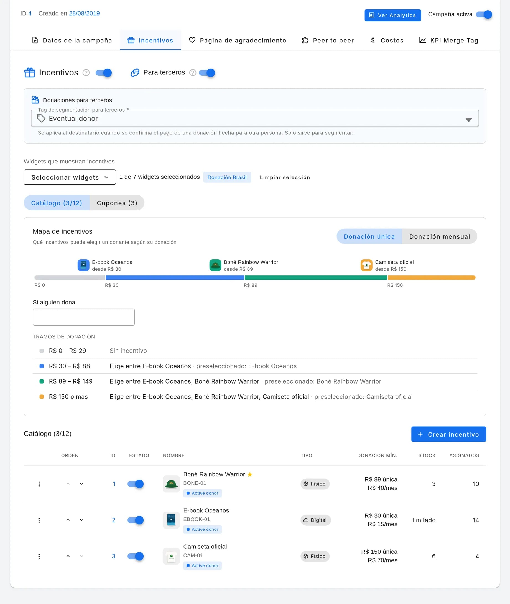

1. **Activa Incentivos** con el interruptor. Si también quieres regalos para terceros, activa **Para terceros** y elige la etiqueta que se aplicará a quienes reciben un regalo (solo sirve para segmentar).
2. **Elige los widgets** que muestran los incentivos. Los widgets que ya usa otra campaña aparecen bloqueados con su nombre.
3. **Arma el catálogo:** crea los incentivos, ordénalos y marca uno como destacado.
4. **Crea cupones** si los necesitas, en la pestaña **Cupones**.
5. **Revisa el mapa y el simulador** antes de publicar.

El interruptor **Incentivos** funciona como apagado de emergencia: al apagarlo, los widgets dejan de mostrar incentivos, pero conservan su selección para cuando lo vuelvas a encender.

## El catálogo

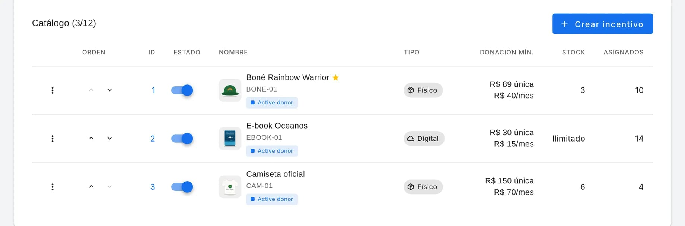

Hasta 12 incentivos por campaña, ordenables. Cada uno tiene estado, foto, SKU, tipo (físico o digital), mínimos por frecuencia, stock y cuántos se asignaron. La estrella marca el destacado.

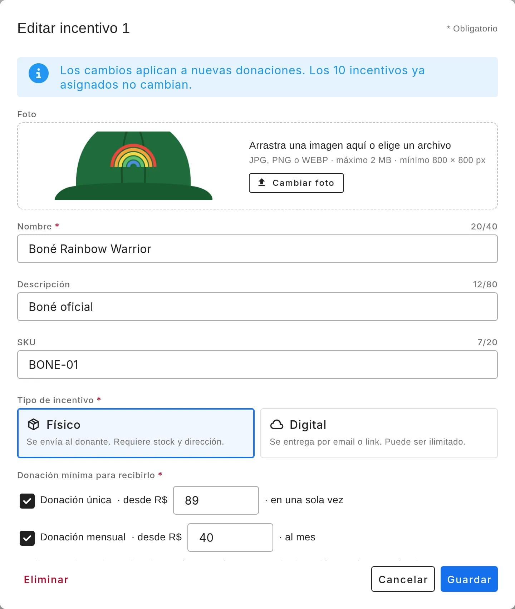

- **Foto** cuadrada, **nombre**, **SKU**, **tipo**, **mínimos** por frecuencia, **stock**, **destacado** y **etiquetas** que se aplican a quien recibe el incentivo.
- El **stock** se protege de ediciones simultáneas: si otra persona lo cambió mientras editabas, la consola te pide recargar.
- El tipo físico o digital no se puede cambiar después de la primera asignación.

## Mapa y simulador

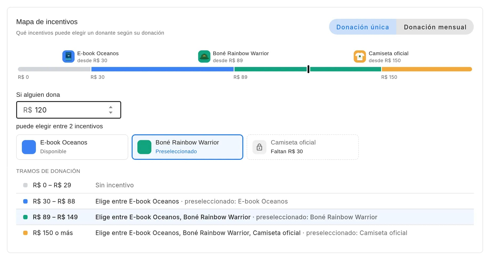

El **mapa** muestra qué desbloquea cada tramo de monto. El **simulador** responde «si alguien dona R$ 120»: cuántos incentivos puede elegir y cuál queda preseleccionado.

## Widgets de la campaña

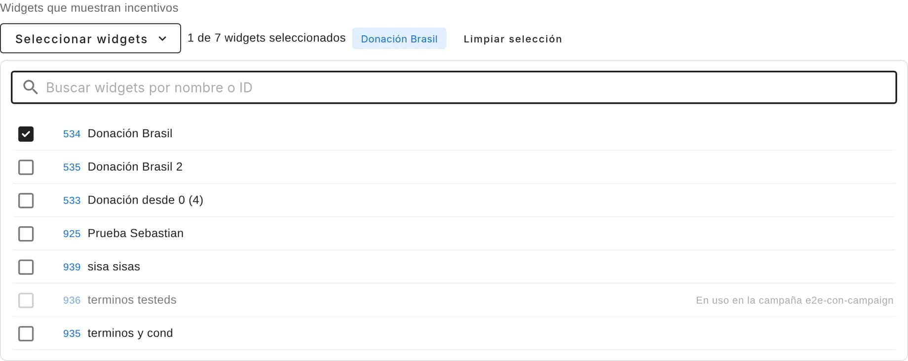

---

# Entregas

## Panel de recompensas

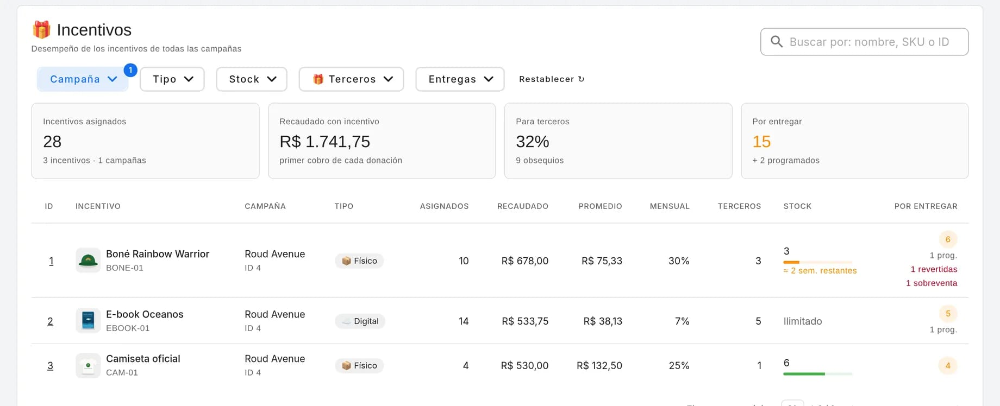

Recompensas asignadas, recaudado con incentivo, porcentaje de regalos para terceros y pendientes de entrega, con una tabla por incentivo.

## Personas que deben recibir un incentivo

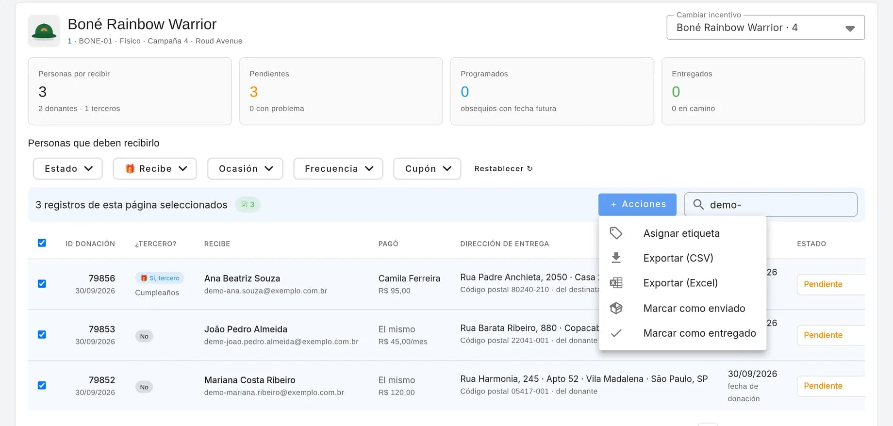

Por cada incentivo: quién pagó y quién recibe, ocasión, dirección de entrega y estado. Con acciones en bloque: marcar como enviado o entregado, asignar etiqueta y exportar a CSV o Excel.

**Estados de entrega:**

| Estado | Significado |
|---|---|
| Pendiente | Asignado, todavía no se envió |
| Programado | Regalo con fecha de envío futura |
| Enviado | En camino |
| Entregado | Recibido |
| Con problema | La entrega automática no pudo completarse (se muestra el motivo) |

- Los incentivos **físicos** se actualizan a mano desde este panel.
- Si la donación se reembolsa o se cancela, su recompensa queda bloqueada y no se puede marcar como enviada.

## Entrega automática con flujos de trabajo

Cada recompensa pagada genera un evento **«Recompensa asignada»**, uno por asignación. Úsalo como disparador de un [flujo de trabajo](../workflows/workflows-guide.md) para enviar la recompensa digital o el aviso de envío.

| Disparador | Correo con certificado |
|---|---|
| 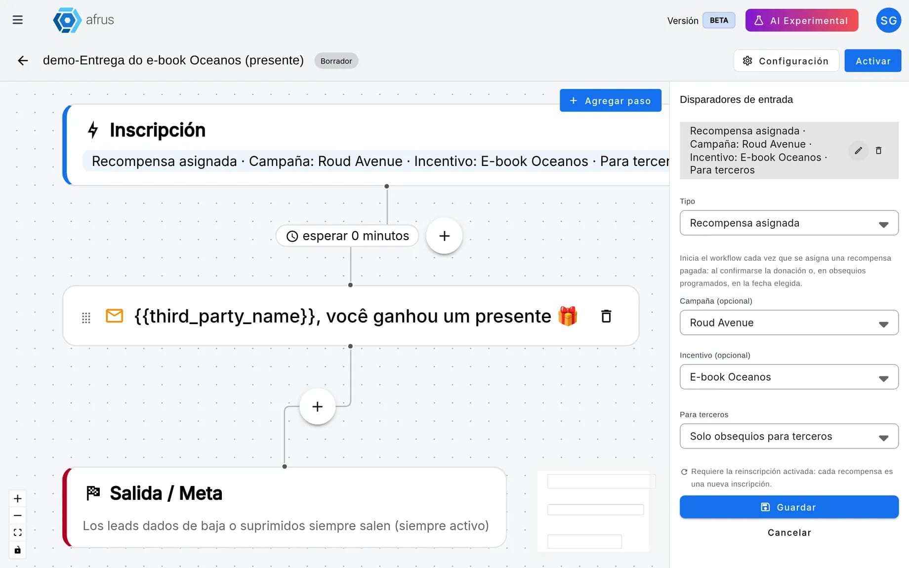 | 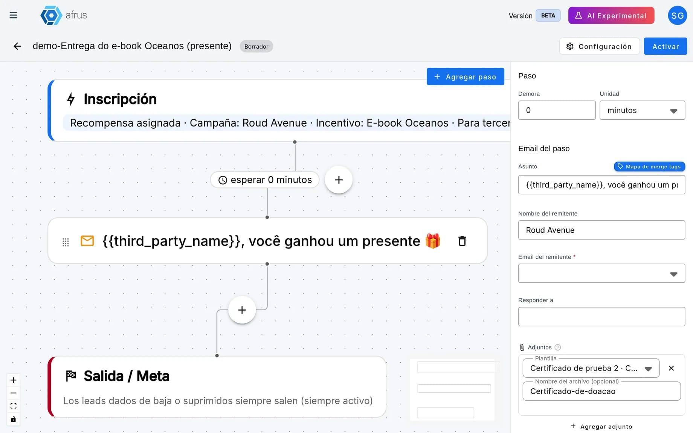 |
| Filtros opcionales por campaña, por incentivo y solo regalos. Requiere permitir la reinscripción. | Etiquetas de personalización de quien recibe en el asunto y un certificado PDF por destinatario. |

- **Por qué un evento y no una etiqueta:** una etiqueta solo dispara un flujo la primera vez que alguien la recibe; una segunda donación o un segundo regalo se perderían. El evento se dispara en cada asignación.
- Si la persona ya está activa en el flujo, se reintenta cada 15 minutos, hasta 5 veces (unas 24 horas).
- Nada se omite en silencio: si no se puede entregar, la recompensa queda con estado «Con problema» y su motivo.
- Las etiquetas de los incentivos siguen existiendo, pero solo para segmentar.

---

# Transacciones y reportes

Cada donación tiene un **tipo de donación**: estándar, con incentivo, peer to peer o de producto.

| Detalle de la donación | Filtro en transacciones |
|---|---|
| 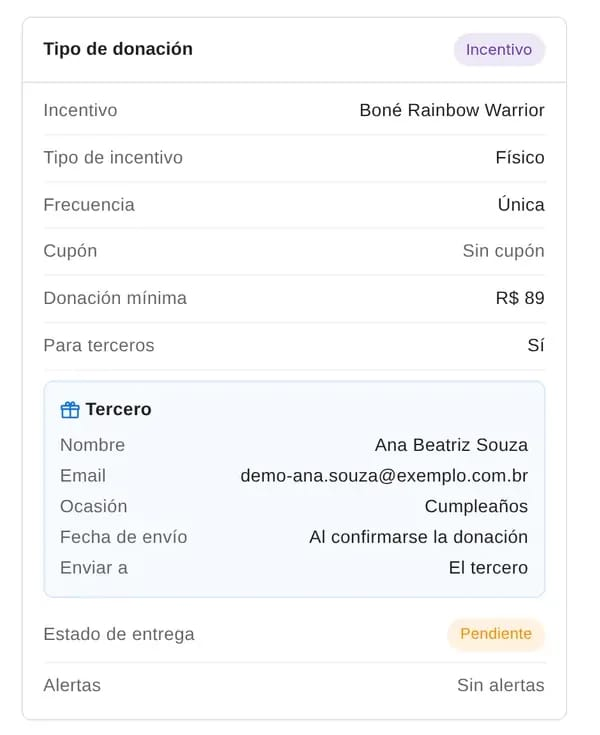 | 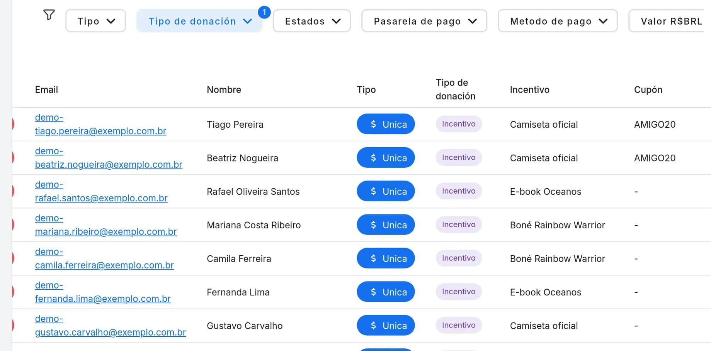 |
| La recompensa, la frecuencia, el cupón, el mínimo y, si fue un regalo, los datos de quien recibe. | Nueva columna y filtro «Tipo de donación», también en las exportaciones. |

Para medir el efecto de los incentivos en la conversión, puedes comparar una landing con incentivos contra una sin ellos con un [experimento A/B](../landing-experiments/ab-testing-guide.md).

---

# Reglas que protegen la promesa

- **Solo con pago confirmado.** En donación única, cuando el pago se aprueba; en mensual, con el primer cargo confirmado. Un pago rechazado no toca el stock, el cupón ni las etiquetas.
- **Stock:** se verifica al reservar y se descuenta al confirmar el pago. Si dos personas toman la última unidad a la vez, ambas reciben su incentivo y la organización recibe una alerta de sobreventa.
- **Reembolsos y contracargos:** la recompensa queda marcada como revertida. El stock y los usos del cupón no se restauran solos.
- **La donación nunca se rechaza por un incentivo:** si algo falla con la recompensa, la donación entra igual sin incentivo.

## Limitaciones conocidas

- Solo widgets de donación; los widgets de producto no muestran incentivos.
- Donación única y mensual; la mensual asigna la recompensa una sola vez.
- Un widget puede mostrar los incentivos de una sola campaña.
- Si el donante cambia de moneda en el widget, no hay incentivos.
- El stock y los cupones no se restauran solos tras un reembolso.

## Preguntas frecuentes

**¿El cupón cambia lo que paga el donante?**
No. Solo baja el mínimo para desbloquear incentivos. El donante paga el monto que elige.

**¿Qué pasa si se agota un incentivo físico?**
Se oculta en el widget. Si dos personas tomaron la última unidad al mismo tiempo, ambas lo reciben y la organización recibe una alerta de sobreventa para resolverlo.

**¿Cuándo se entrega una recompensa de una donación mensual?**
Una sola vez, cuando se confirma el primer cargo.

**¿Quien recibe un regalo empieza a recibir correos de la organización?**
Se agrega solo con el canal de correo y con un origen propio. Si ya era contacto, mantiene su consentimiento.

**¿Puedo usar etiquetas para disparar la entrega?**
Es mejor usar el disparador «Recompensa asignada»: una etiqueta solo dispara un flujo la primera vez y las siguientes recompensas se perderían.

---

> **[Volver al índice de la sección](./README.md)** · **[Volver al índice general](../README.md)**

*Última actualización: 2026-10-08*
