# Guía de uso de Entradas (venta de entradas con QR)

Paso a paso para vender entradas a un evento desde AFRUS: crear el evento, ponerlo en un widget, recibir compras, registrar a los invitados, enviar los códigos QR, gestionar compras y controlar el ingreso en la puerta con un teléfono.

*Módulo: Eventos · Ubicación: consola > Eventos y editor del widget > Producto · Audiencia: equipos de eventos y fundraising, Customer Success*

> **Versión PDF:** [guia-de-uso-entradas-afrus.pdf](./guia-de-uso-entradas-afrus.pdf) (38 páginas, A4 horizontal).
>
> Las capturas son de un entorno de prueba con datos ficticios (correos `@afrus.test`, tarjeta de prueba). Los recuadros rosados y sus números corresponden a la lista de cada paso. Para entender el módulo antes de usarlo, lee también [Cómo funciona Entradas](./how-it-works.md).

---

## Antes de empezar

- **Entradas se habilita por organización.** Si en la consola no ves la sección **Eventos**, pide a Customer Success de AFRUS que la active para tu organización.
- **Ten a mano un widget con meta «Producto».** Las entradas se venden como un producto más del widget.
- **El pago con PayPal todavía no está disponible para entradas.** Usa las otras pasarelas del widget.

## Contenido

- **Parte 1 — Consola:** La ONG crea el evento y abre la venta (pasos 1, 2, 3, 4, 5)
- **Parte 2 — Builder:** La entrada se pone en un widget (pasos 6)
- **Parte 3 — Compra:** El donante compra en el widget (pasos 7)
- **Parte 4 — Comprador e invitados:** Registro, correos y la entrada con QR (pasos 8, 9, 10, 11)
- **Parte 5 — Gestión:** Resumen, compras, reenvíos y anulaciones (pasos 12, 13, 14)
- **Parte 6 — Puerta:** El escáner el día del evento (pasos 15, 16, 17, 18)

---

# Parte 1 — Consola

La ONG crea el evento y abre la venta.

## Paso 1 — Consola → Eventos

La sección donde vive todo lo de entradas.

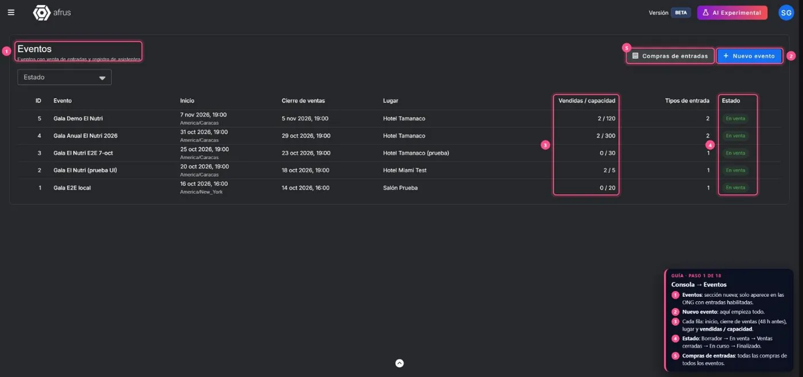

1. **Eventos** es una sección nueva del menú. Solo aparece en las ONG que tienen entradas habilitadas.
2. **Nuevo evento**: aquí empieza todo.
3. Cada fila muestra inicio, cierre de ventas (48 h antes, automático), lugar y **vendidas / capacidad**.
4. **Estado**: Borrador → En venta → Ventas cerradas → En curso → Finalizado. Las ventas se cierran solas en el cierre.
5. **Compras de entradas**: todas las compras de todos los eventos en una lista.

## Paso 2 — Crear el evento

Un formulario con todo lo que necesitan los correos y las páginas del invitado.

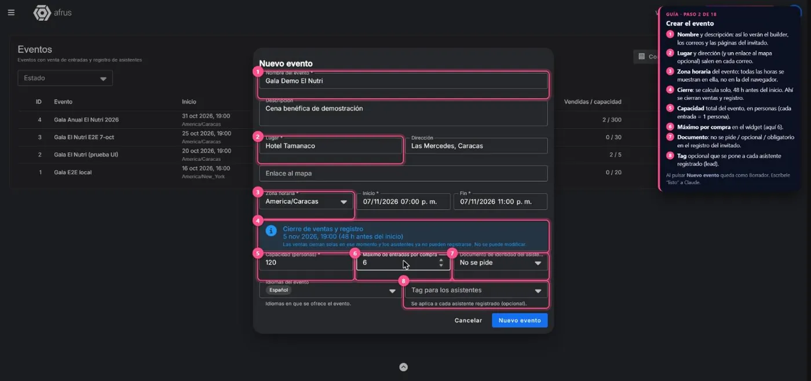

1. **Nombre y descripción**: así lo verán el builder, los correos y las páginas del invitado.
2. **Lugar y dirección** (y un enlace al mapa opcional) salen en cada correo.
3. **Zona horaria**: todas las horas se muestran en la del evento, no en la del navegador.
4. **Cierre de ventas y registro**: se calcula solo, 48 h antes del inicio. Ahí se cierran ventas y registro.
5. **Capacidad** total del evento, en personas: cada entrada admite a una persona.
6. **Máximo por compra** en el widget.
7. **Documento de identidad** del invitado: no se pide, opcional u obligatorio.
8. **Tag** opcional que se pone a cada asistente registrado (su lead).

> **Bueno saber:** Al pulsar «Nuevo evento» queda como Borrador: todavía no se vende.

## Paso 3 — Borrador y revisión previa

Antes de vender, Afrus revisa que todo esté listo.

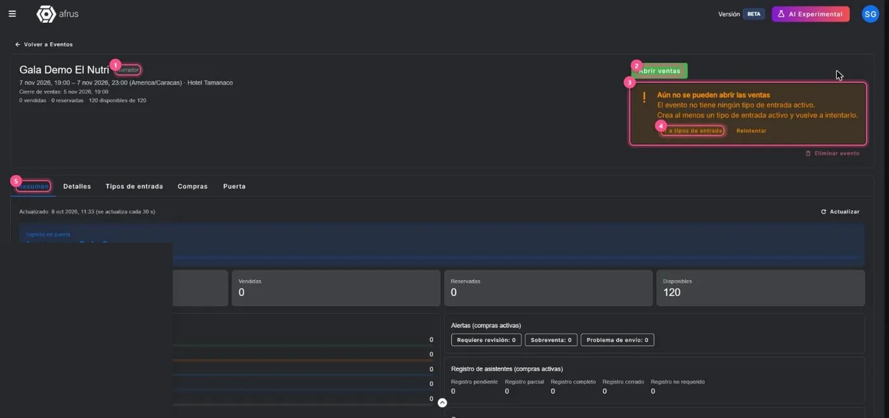

1. El evento se creó como **Borrador**.
2. **Abrir ventas** corre una revisión automática antes de poner el evento en venta.
3. Si falta algo, lo dice: aquí, un tipo de entrada. También revisa las plantillas de correo, el almacenamiento de los QR y la regla de PayPal.
4. **Ir a tipos de entrada** lleva directo a arreglarlo.
5. Pestañas del evento: Resumen, Detalles, Tipos de entrada, Compras y **Puerta** (el escáner).

> **Bueno saber:** Arriba del Resumen está el contador de la puerta, «Ingresaron 0 de 0».

## Paso 4 — Tipos de entrada

General, VIP, Mesa… cada uno con su capacidad.

### Nuevo tipo de entrada

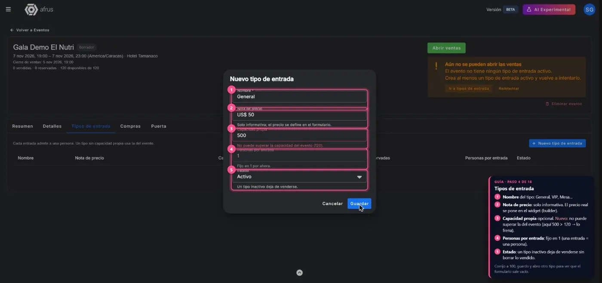

1. **Nombre** del tipo.
2. **Nota de precio**: solo informativa. El precio real se define en el widget.
3. **Capacidad propia** opcional. No puede superar la del evento: aquí 500 > 120 y el formulario lo frena.
4. **Personas por entrada**: fijo en 1.
5. **Estado**: un tipo inactivo deja de venderse sin borrar lo vendido.

### Tipos creados

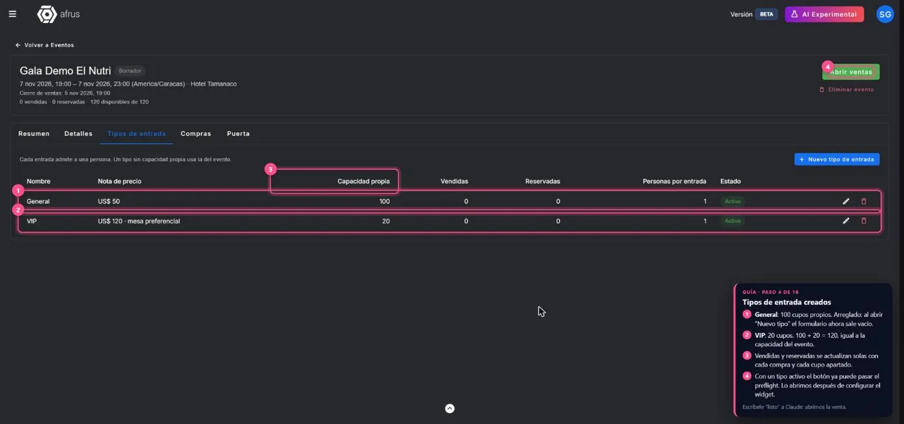

1. **General**: 100 cupos.
2. **VIP**: 20 cupos. 100 + 20 = 120, la capacidad del evento.
3. **Vendidas y reservadas** se actualizan solas con cada compra y cada cupo apartado.
4. Con un tipo activo, **Abrir ventas** ya pasa la revisión.

> **Bueno saber:** Al abrir «Nuevo tipo» por segunda vez, el formulario sale vacío.

## Paso 5 — Venta abierta y el Resumen

El tablero del evento, que se actualiza cada 30 segundos.

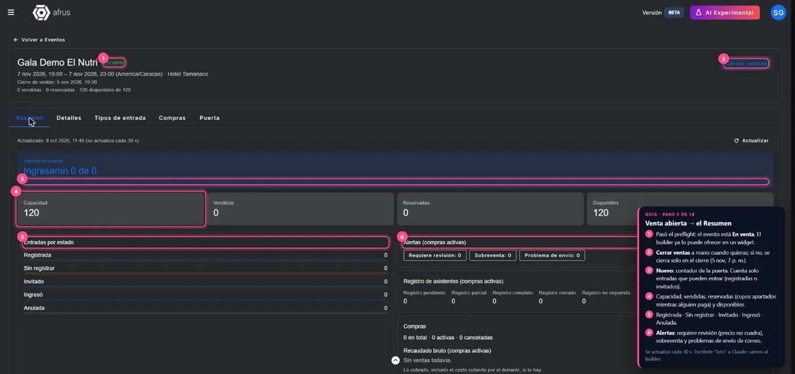

1. El evento está **En venta**: el builder ya lo ofrece.
2. **Cerrar ventas** a mano; si no, se cierra solo en el cierre.
3. **Ingreso en puerta**: cuenta solo entradas que pueden entrar (registradas o invitados).
4. Capacidad, vendidas, **reservadas** (cupos apartados mientras alguien paga) y disponibles.
5. **Entradas por estado**: Registrada · Sin registrar · Invitado · Ingresó · Anulada.
6. **Alertas**: requiere revisión (el precio no cuadra), sobreventa y problemas de envío.

---

# Parte 2 — Builder

La entrada se pone en un widget.

## Paso 6 — La entrada como producto del widget

En un widget con meta «Producto» aparece el tipo «Entrada de evento».

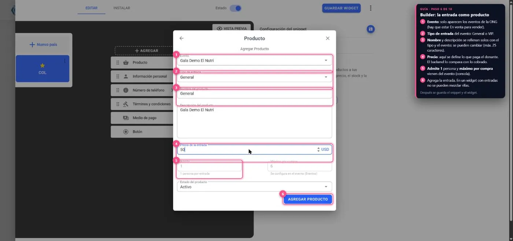

1. **Evento** de la ONG.
2. **Tipo de entrada** del evento: General o VIP.
3. **Nombre y descripción** se rellenan solos; se pueden cambiar (máximo 25 caracteres).
4. **Precio**: lo que paga el donante. Afrus lo compara con lo cobrado.
5. **Admite 1** persona y **máximo por compra** vienen del evento.
6. **Agregar producto**. En un widget con entradas no se pueden mezclar rifas.

> **Bueno saber:** Arriba del snippet hay dos avisos: las entradas no usan cupones ni incentivos, y PayPal todavía está bloqueado para entradas. Guarda seguido: cerrar el editor descarta lo no guardado.

---

# Parte 3 — Compra

El donante compra en el widget.

## Paso 7 — El donante compra

Igual que una donación: elige cantidades, deja sus datos y paga.

### El widget

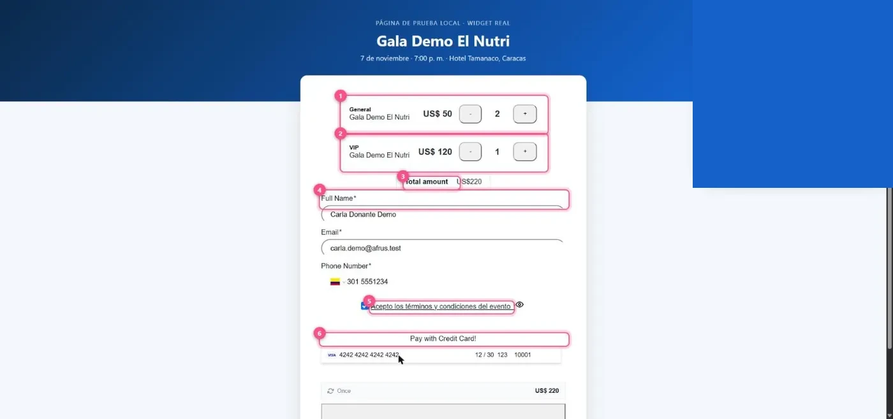

1. Cada **tipo de entrada** es una línea con precio y cantidad (+/−).
2. Se pueden **combinar tipos** en una sola compra.
3. **Total**. Antes de cobrar, el widget aparta los cupos 15 minutos; si no hay cupo, avisa antes de pagar.
4. Datos del **comprador**: nombre, correo y teléfono.
5. **Términos** del evento.
6. **Pago** con la pasarela del widget (aquí Stripe en modo prueba).

### Pago confirmado

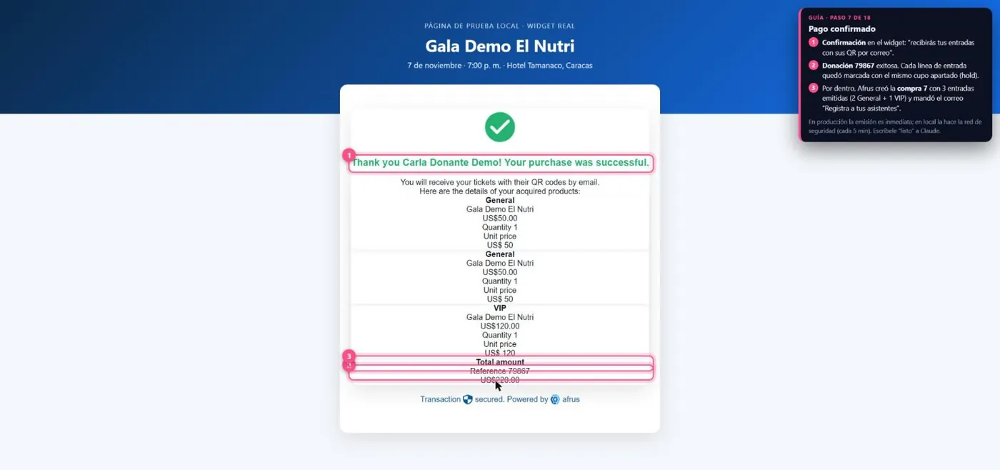

1. **Confirmación**: «recibirás tus entradas con sus QR por correo».
2. La **donación** queda exitosa y cada línea de entrada lleva el mismo cupo apartado.
3. Afrus crea la **compra** con sus entradas y manda el correo «Registra a tus asistentes».

---

# Parte 4 — Comprador e invitados

Registro, correos y la entrada con QR.

## Paso 8 — Correo «Registra a tus asistentes»

Llega solo al comprador apenas se emite la compra.

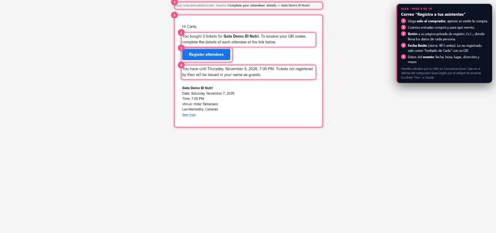

1. Llega **solo al comprador**.
2. Cuántas entradas compró y para qué evento.
3. **Botón** a su página privada de registro, donde llena los datos de cada persona.
4. **Fecha límite** (48 h antes). Lo no registrado sale como «Invitado de [comprador]» con su QR.
5. Datos del **evento**: fecha, hora, lugar, dirección y mapa.

> **Bueno saber:** Si no registra a todos, recibe recordatorios 7 y 3 días antes del evento.

## Paso 9 — Página de registro

Una tarjeta por entrada; cada una se guarda por separado.

### Al abrirla

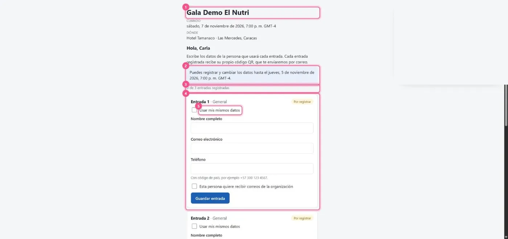

1. El **evento** con fecha, hora y lugar.
2. **Fecha límite** para registrar y corregir datos.
3. **Avance** del registro.
4. **Una tarjeta por entrada**, con su tipo y estado.
5. **Usar mis mismos datos**: el comprador se queda con una entrada.

### Después de registrar

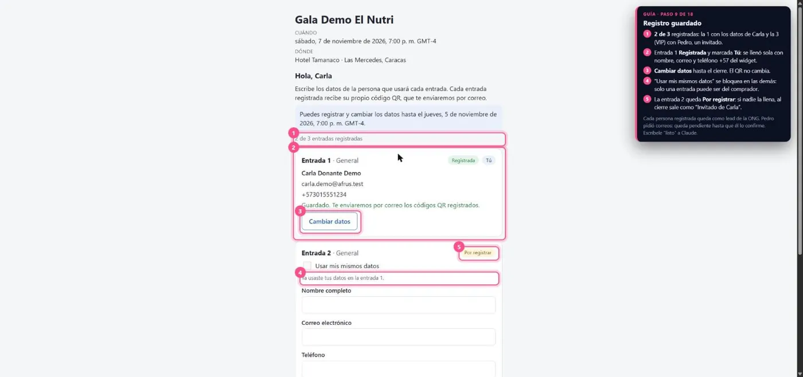

1. **2 de 3** registradas.
2. La entrada del comprador queda **Registrada** y marcada **Tú**.
3. **Cambiar datos** hasta el cierre; el QR no cambia.
4. «Usar mis mismos datos» se bloquea en las demás tarjetas.
5. La que falta queda **Por registrar**.

> **Bueno saber:** Cada persona registrada queda como lead de la ONG. Si el comprador marca que un invitado quiere correos, queda pendiente hasta que el invitado lo confirme.

## Paso 10 — Correo con los QR

Un QR por persona registrada, con su nombre.

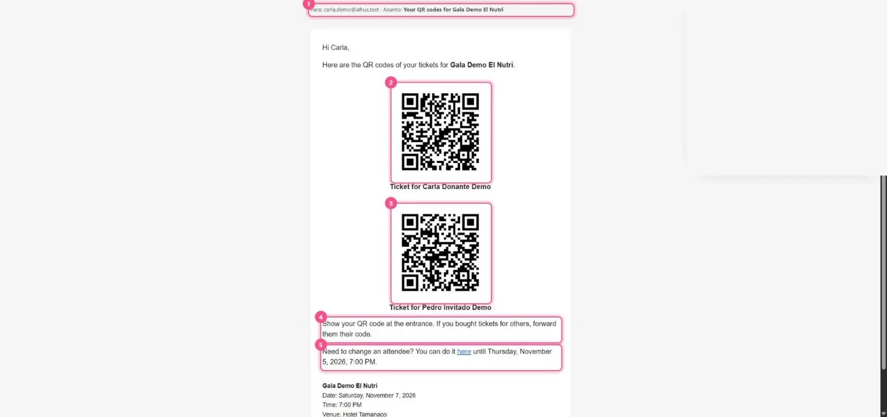

1. Va al **comprador**; se manda al registrar (agrupado si registra varias seguidas).
2. **Un QR por persona**, como imagen alojada, para que Gmail y Outlook la muestren.
3. El comprador le **reenvía** su QR a cada invitado; al tocarlo se abre su entrada.
4. Instrucciones para la puerta.
5. **Enlace de registro** para cambiar un asistente o registrar el que falta, hasta el cierre.

## Paso 11 — La entrada del invitado

Lo que el invitado ve en su teléfono.

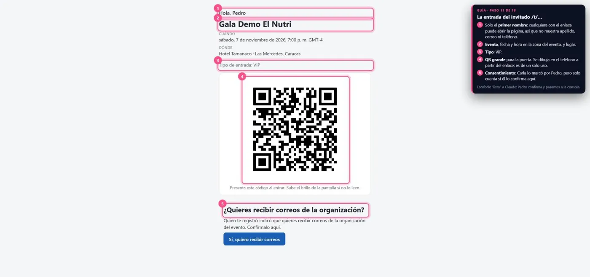

1. Solo el **primer nombre**: cualquiera con el enlace puede abrir la página, así que no muestra apellido, correo ni teléfono.
2. El **evento**, con fecha y hora en la zona del evento, y el lugar.
3. **Tipo de entrada**.
4. **QR grande** de un solo uso para la puerta.
5. **Consentimiento**: si el comprador marcó que quiere correos, el invitado lo confirma aquí.

> **Bueno saber:** Si la entrada se anula, esta página lo muestra. Si se reemite, el enlace viejo deja de funcionar al instante.

---

# Parte 5 — Gestión

Resumen, compras, reenvíos y anulaciones.

## Paso 12 — El Resumen con ventas

El estado del evento de un vistazo.

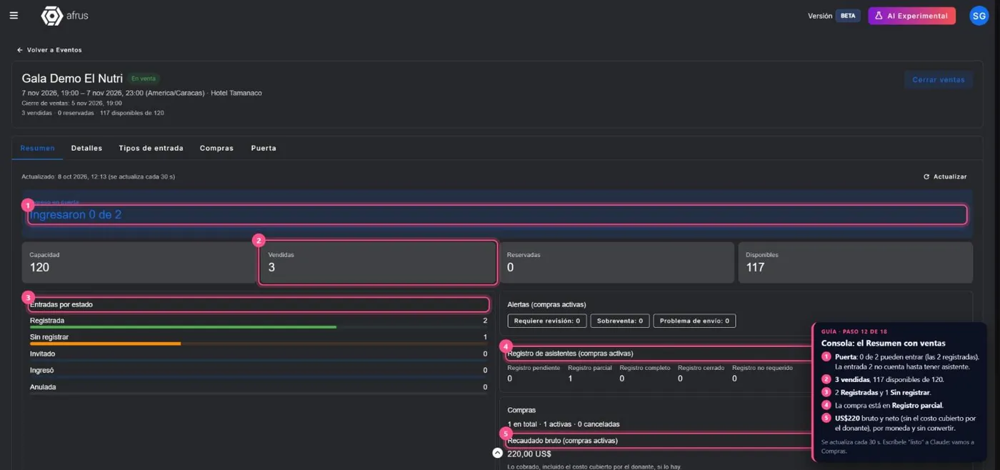

1. **Ingreso en puerta**: cuenta solo las entradas que pueden entrar.
2. **Vendidas**, reservadas y disponibles.
3. **Entradas por estado**.
4. **Registro de asistentes**: pendiente, parcial, completo, cerrado.
5. **Recaudado** bruto y neto, por moneda y sin convertir.

## Paso 13 — Detalle de la compra

Todo sobre una compra en un solo lugar.

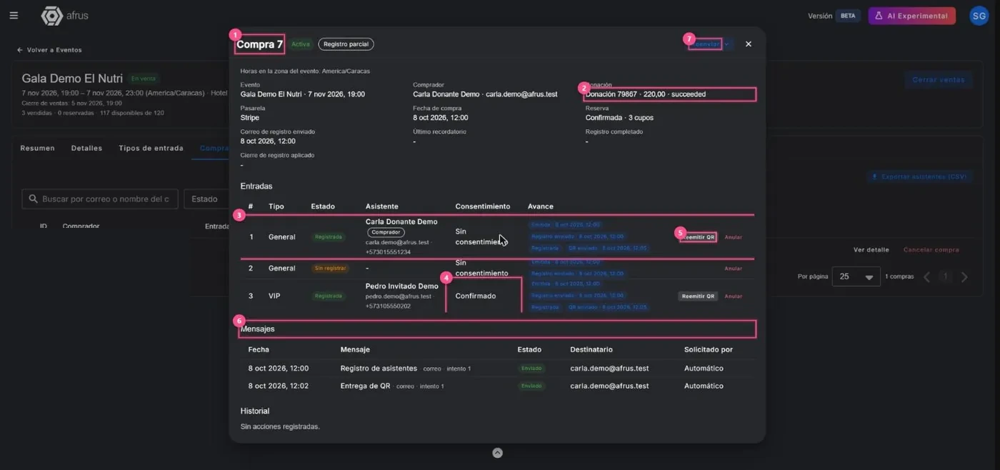

1. **Compra** con su estado y el avance del registro.
2. La **donación** que la pagó y la **reserva** de cupos.
3. Cada **entrada**: tipo, estado, asistente, consentimiento y avance paso a paso.
4. **Consentimiento confirmado** por el invitado.
5. **Reemitir QR** (el viejo deja de servir) y **Anular** una entrada.
6. **Mensajes** enviados: a quién, cuándo, estado y si fue automático.
7. **Reenviar**: recibo de compra, enlace de registro o QR.

> **Bueno saber:** Abajo, el Historial registra cada acción manual con usuario y hora.

## Paso 14 — Reenviar y anular

Las dos acciones más comunes del día a día.

### Reenviar el recibo

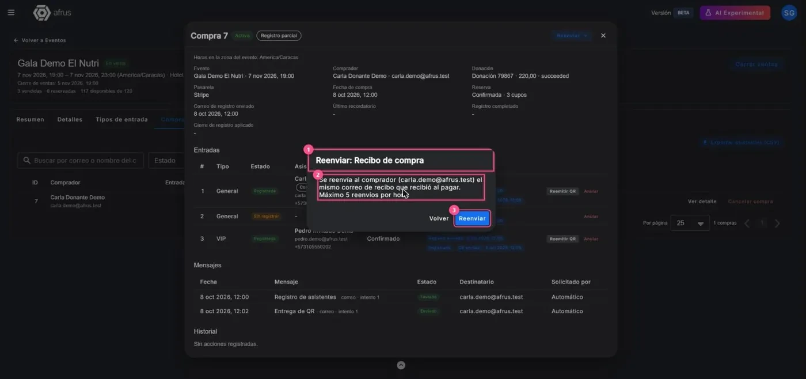

1. **Recibo de compra**: el mismo correo que el comprador recibió al pagar.
2. Solo al **comprador**, máximo **5 por hora**.
3. Queda en cola y en el **Historial**.

### Anular una entrada

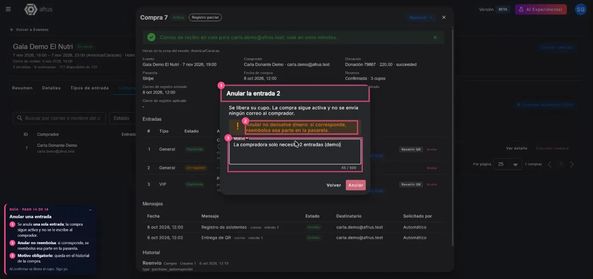

1. Se anula **una sola entrada**; la compra sigue activa.
2. **Anular no reembolsa**: si corresponde, se reembolsa en la pasarela.
3. **Motivo obligatorio**.

### Resultado

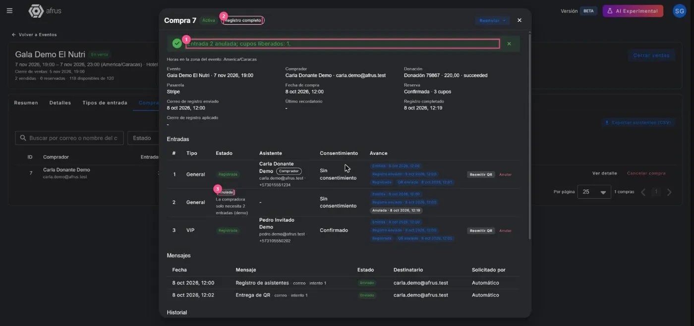

1. **Cupo liberado**: vuelve a estar a la venta.
2. La compra pasa a **Registro completo**.
3. La entrada queda **Anulada** con su motivo.
4. **Historial** con el reenvío y la anulación.

---

# Parte 6 — Puerta

El escáner el día del evento.

## Paso 15 — Dispositivo de puerta

Un enlace por teléfono; no hace falta cuenta de Afrus en la puerta.

### Nuevo dispositivo

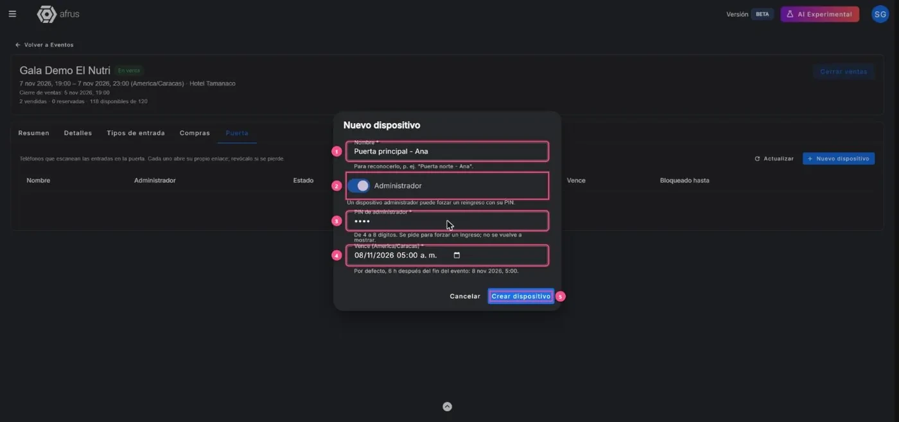

1. **Nombre** para reconocer el teléfono.
2. **Administrador**: puede forzar un reingreso.
3. **PIN** de 4 a 8 dígitos, guardado cifrado. 5 errores bloquean el teléfono 15 minutos.
4. **Vencimiento**: por defecto 6 h después del fin del evento.
5. **Crear dispositivo**.

### El enlace (se ve una sola vez)

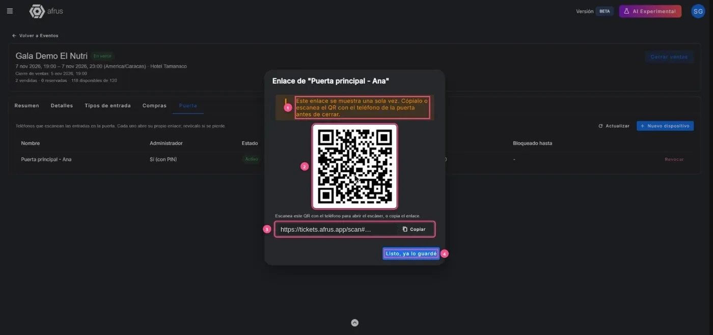

1. Se muestra **una sola vez**.
2. **QR del enlace**: se escanea con el teléfono de la puerta.
3. O se **copia el enlace** y se manda al teléfono.
4. Al cerrar, el dispositivo queda en la lista y se puede **revocar**.

## Paso 16 — El escáner

La pantalla del teléfono de la puerta.

### Pantalla principal

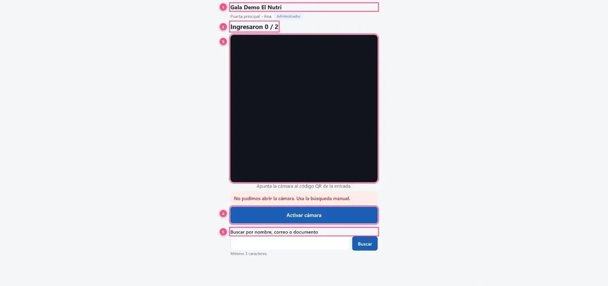

1. **Evento** y **dispositivo**. El enlace se quita de la barra de direcciones.
2. **Contador en vivo**, el mismo que ve la consola.
3. **Cámara**: apunta al QR y lee solo.
4. **Activar cámara** pide permiso al teléfono.
5. **Búsqueda manual** por nombre, correo o documento.

### Verde: VÁLIDA

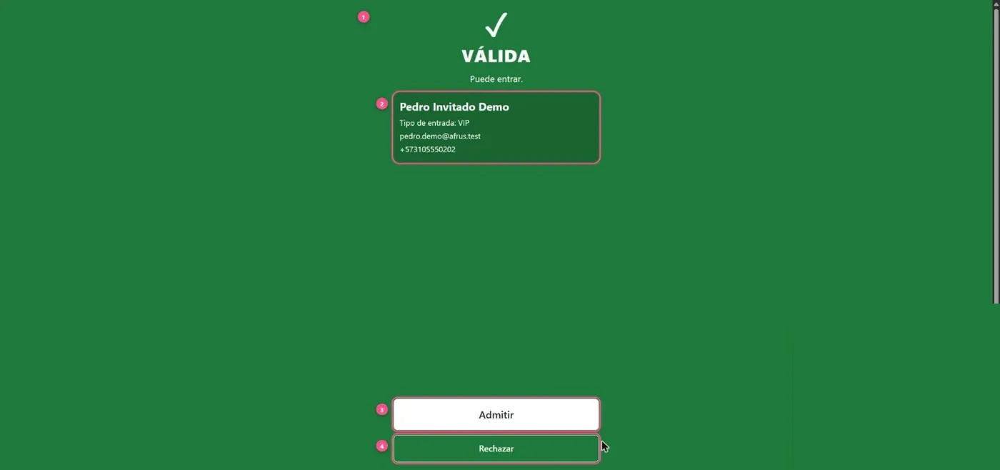

1. **Válida**: entrada registrada que todavía no entró. Siempre con ícono y palabra.
2. **Datos del asistente** para verificar.
3. **Escanear no deja entrar**: hay que pulsar Admitir. Si dos puertas admiten a la vez, solo una gana.
4. **Rechazar** con motivo.

> **Bueno saber:** En la demo este PC no tenía cámara, por eso se usó la búsqueda manual, que muestra el mismo resultado.

## Paso 17 — Admitir, ya ingresó y forzar ingreso

Un QR, una entrada.

### Admitido

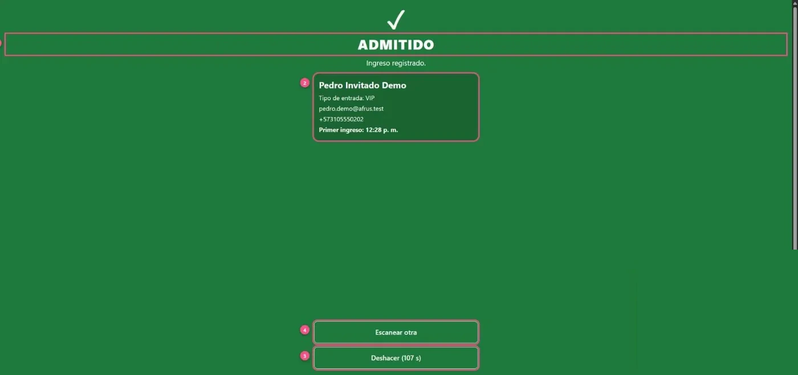

1. El **ingreso** queda registrado con hora y teléfono.
2. **Primer ingreso** y el contador sube.
3. **Deshacer** durante 2 minutos, solo desde ese teléfono.
4. **Escanear otra**.

### Amarillo: YA INGRESÓ

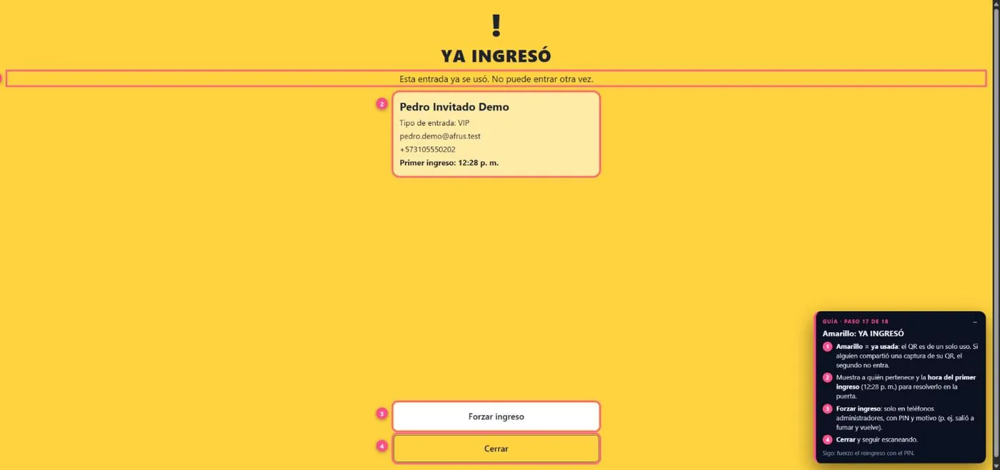

1. El QR es de **un solo uso**: una captura compartida no entra dos veces.
2. A quién pertenece y la **hora del primer ingreso**.
3. **Forzar ingreso**: solo teléfonos administradores.
4. **Cerrar** y seguir.

### Forzar ingreso

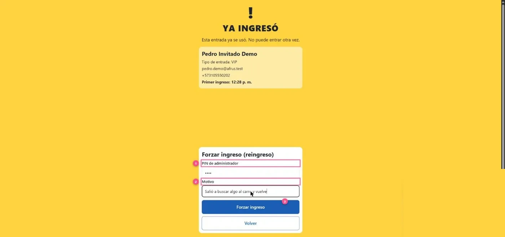

1. **PIN** del teléfono administrador.
2. **Motivo** obligatorio.
3. Queda como **reingreso**; la entrada sigue usada y el contador no cambia.

## Paso 18 — Sin conexión y contador en vivo

La puerta sigue funcionando aunque se caiga la señal.

### Sin señal: valida con la lista guardada

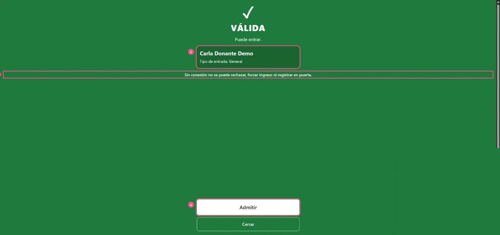

1. **Válida sin internet**: el teléfono compara la huella del QR con la lista que guardó.
2. Muestra nombre y tipo; correo y teléfono no se guardan en el teléfono.
3. Sin conexión no se puede rechazar, forzar ingreso ni registrar en puerta.
4. **Admitir** sí: queda como ingreso provisional.

### En cola

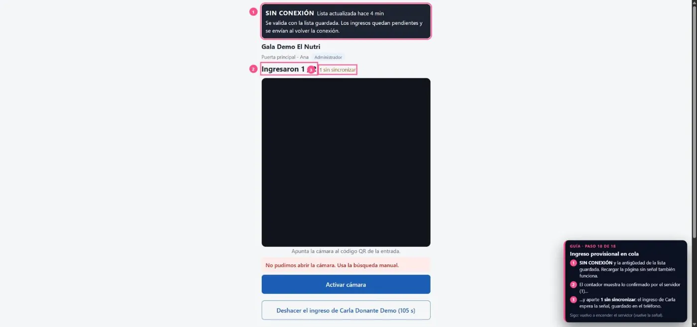

1. **SIN CONEXIÓN** y la antigüedad de la lista. Recargar sin señal también funciona.
2. El contador muestra lo confirmado por el servidor…
3. …y aparte **1 sin sincronizar**.

### Vuelve la señal

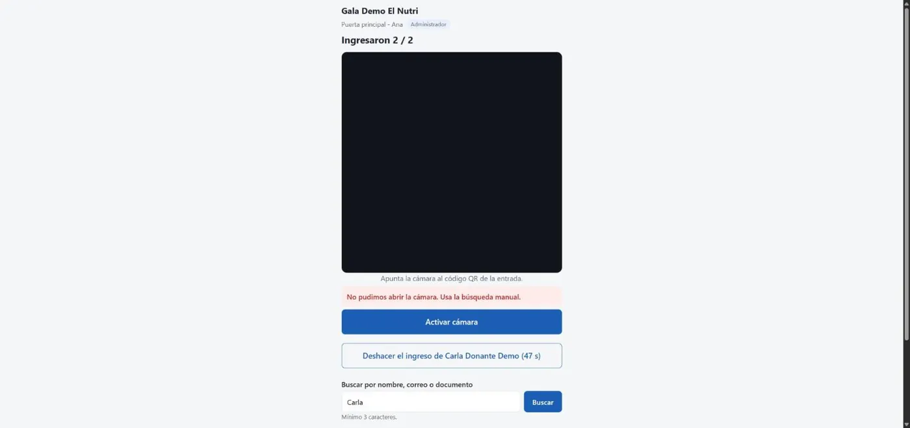

1. Se sincroniza solo: el aviso desaparece y el contador sube.
2. Si otra puerta lo hubiera admitido mientras tanto, se marca como conflicto y se muestra.

### La consola ve la puerta

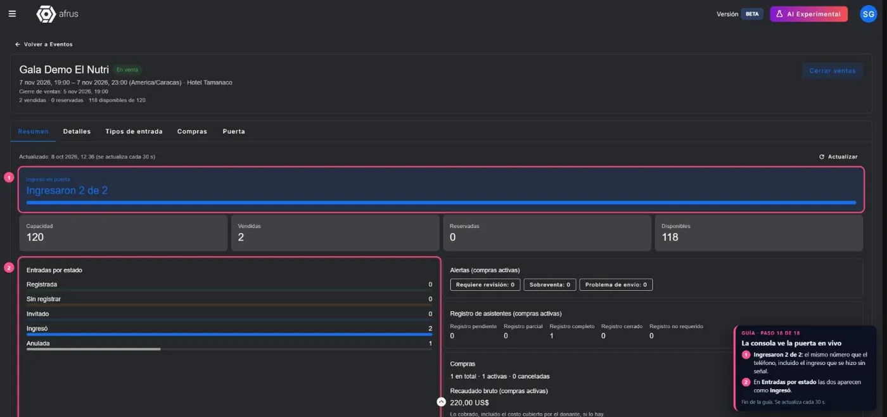

1. **Ingresaron 2 de 2**: el mismo número que el teléfono, incluido el ingreso sin señal.
2. En **Entradas por estado** aparecen como Ingresó.

---

## Preguntas frecuentes

**¿Se puede comprar más de una entrada a la vez?**
Sí. El donante elige la cantidad de cada tipo en el widget, hasta el máximo por compra que defines en el evento.

**¿Quién registra a los invitados?**
El comprador, desde el enlace que recibe por correo. Puede quedarse con una entrada usando sus propios datos y registrar a cada invitado en su tarjeta. Si no registra a alguien antes del cierre, esa entrada sale a nombre de «Invitado de [comprador]» con su QR.

**¿Qué pasa si un invitado comparte su QR?**
El QR es de un solo uso. La segunda persona que lo presente verá «Ya ingresó» con la hora del primer ingreso. Si el QR se compartió por error, puedes reemitirlo desde el detalle de la compra: el anterior deja de funcionar al instante.

**¿Anular una entrada devuelve el dinero?**
No. Anular libera el cupo y deja la entrada sin efecto. Si corresponde un reembolso, hazlo en la pasarela de pago.

**¿Qué pasa si se cae la señal en la puerta?**
El escáner sigue funcionando con la lista guardada en el teléfono: valida los QR y admite a las personas como ingresos provisionales. Cuando vuelve la señal, se sincronizan solos y el contador se actualiza.

**¿Hace falta una cuenta de AFRUS en la puerta?**
No. Cada teléfono usa su propio enlace de dispositivo, creado en la pestaña **Puerta** del evento. Si un teléfono se pierde, revoca su enlace.

---

> **[Volver al índice de la sección](./README.md)** · **[Volver al índice general](../README.md)**

*Última actualización: 2026-10-28*
