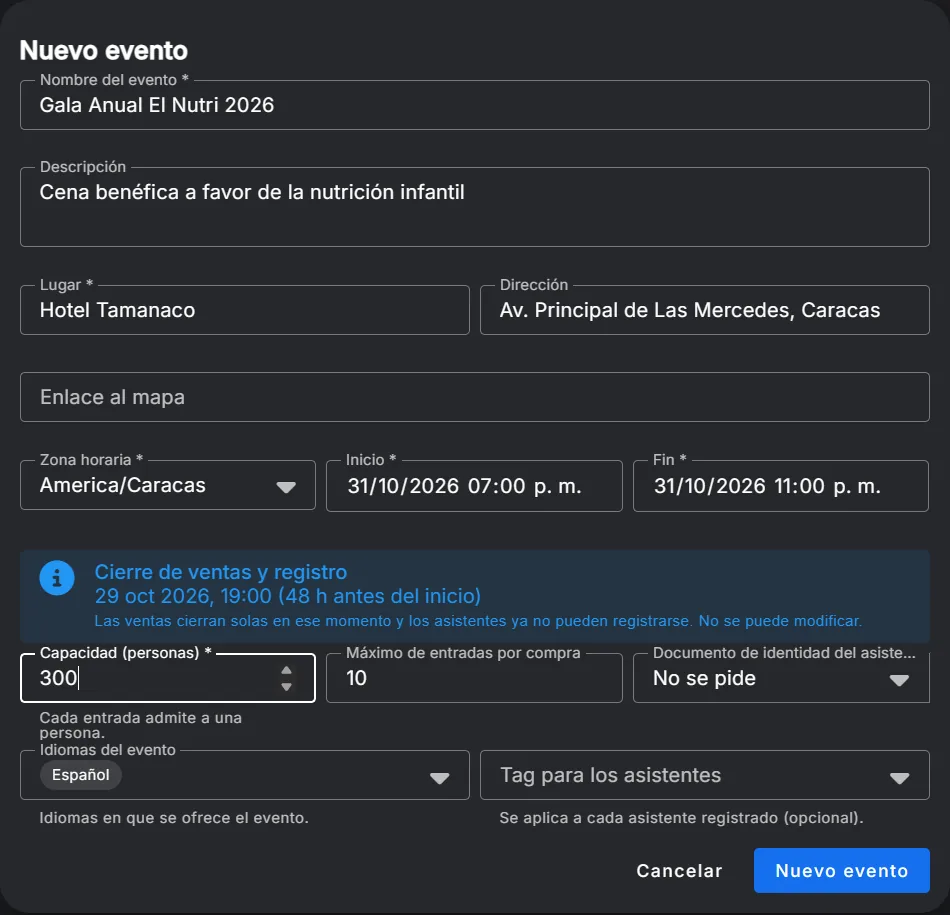
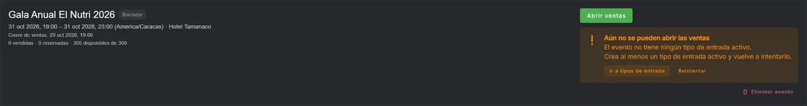
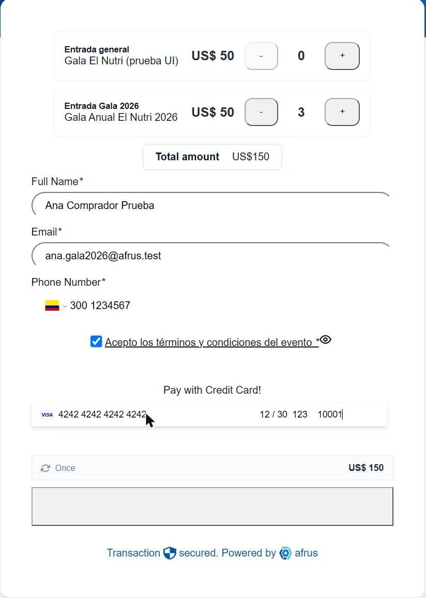
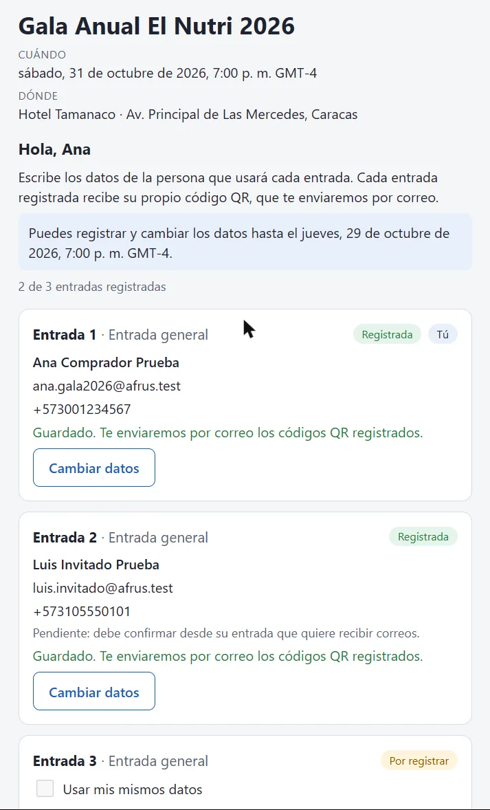
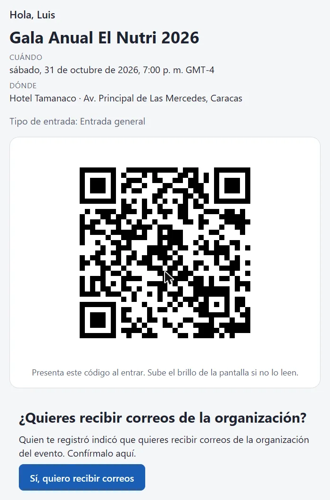
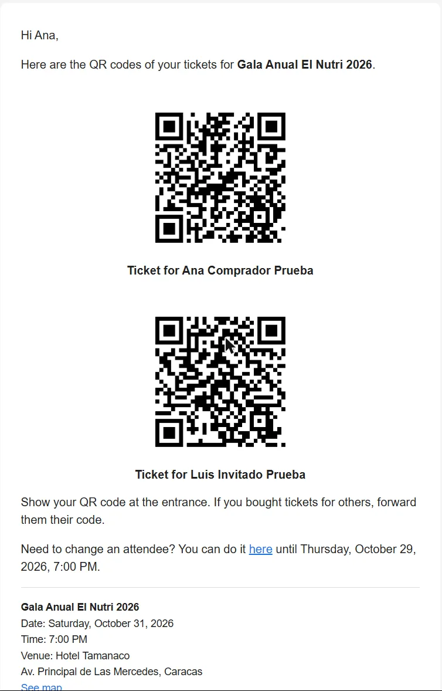
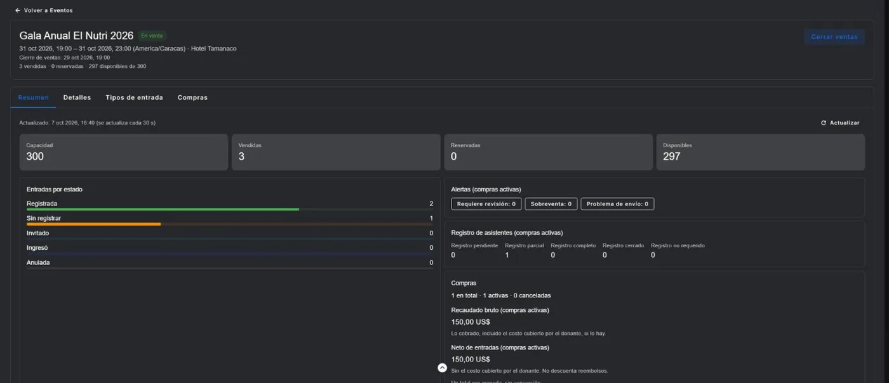

# Cómo funciona Entradas

Qué hace el módulo de entradas con QR, cómo viaja una entrada desde la compra hasta la puerta y qué reglas protegen el dinero y los datos. Para el paso a paso con capturas, ve la [Guía de uso de Entradas](./event-ticketing-guide.md).

*Módulo: Eventos · Audiencia: equipos de eventos y fundraising, Customer Success, equipos técnicos que integran el widget*

---

## Qué es

**Entradas convierte un widget de donación en una boletería.** La organización crea un evento con sus tipos de entrada y los pone a la venta como un producto más del widget. El donante compra como en cualquier donación; después registra a sus invitados, cada uno recibe su propio código QR y, el día del evento, la puerta controla el ingreso con un teléfono.

En tres frases:

1. **La entrada es un producto más del widget.** Se paga con las pasarelas de siempre y el cupo se aparta mientras la persona paga.
2. **Cada cupo se convierte en una persona con nombre.** Al confirmarse el pago, AFRUS emite las entradas y el comprador registra a sus invitados; cada invitado recibe su QR.
3. **La organización ve todo en la consola:** ventas, cupos, quién se registró, quién entró, y puede anular, reemitir, reenviar y exportar.

## Quién participa

| Persona | Qué hace | Dónde |
|---|---|---|
| La organización | Crea el evento y los tipos de entrada, abre la venta, sigue el tablero, anula y exporta | Consola (Eventos) y editor del widget |
| El comprador | Compra en el widget, recibe el recibo y el enlace para registrar a su grupo | Widget y correo |
| El invitado | Recibe su QR y lo ve en su teléfono; puede confirmar que quiere recibir correos | Correo y página de la entrada |
| El personal de la puerta | Escanea los QR y admite a las personas | Teléfono con el enlace del dispositivo |

## La vida de una entrada

1. **Se crea el evento** en la consola: fecha, lugar, zona horaria, capacidad y tipos de entrada. Antes de abrir la venta, una revisión automática confirma que todo esté listo.
2. **Se pone en un widget** con meta «Producto»: se elige el evento y el tipo, y el precio se define en el widget.
3. **Se aparta el cupo.** Antes de cobrar, el widget reserva los cupos por 15 minutos. Si no hay cupo suficiente, avisa antes de pagar.
4. **Se paga** con la pasarela del widget.
5. **Se emiten las entradas** en cuanto el pago se confirma: una compra con una entrada por cupo.
6. **Se registra cada invitado.** El comprador recibe un enlace privado y llena los datos de cada entrada.
7. **Llega el QR.** Un correo con un QR por persona registrada y una página por entrada con el QR grande.
8. **Se entra al evento.** El teléfono de la puerta escanea el QR: un solo ingreso por entrada.

## El evento y sus tipos de entrada

- **Capacidad del evento:** el total de personas. Cada entrada admite a una persona.
- **Tipos de entrada** (General, VIP, Mesa…): cada uno puede tener su propia capacidad, que nunca supera la del evento. La nota de precio es informativa; el precio real se define en el widget.
- **Cierre de ventas y de registro:** se calcula solo, 48 horas antes del inicio, en la zona horaria del evento. A esa hora se cierran las ventas y el registro de invitados.
- **Revisión previa:** al pulsar **Abrir ventas**, AFRUS comprueba que haya al menos un tipo de entrada activo, que estén las plantillas de correo y que la configuración de pagos sea compatible. Si falta algo, dice exactamente qué.

## El widget

En un widget con meta «Producto» aparece el tipo **Entrada de evento**. Se elige el evento y el tipo de entrada; el nombre y la descripción se rellenan solos y el precio se define ahí.

- Una entrada no se combina con rifas ni con cupones o incentivos.
- El donante puede combinar tipos (por ejemplo, 2 General y 1 VIP) hasta el máximo por compra.
- Mientras paga, sus cupos quedan apartados 15 minutos. Si el pago queda pendiente (por ejemplo, una transferencia bancaria por confirmar), el cupo se mantiene más tiempo en vez de soltarse.

## Registro de invitados

El comprador recibe el correo **«Registra a tus asistentes»** con un enlace privado a una página con una tarjeta por entrada.

- Por cada invitado se pide nombre, correo y teléfono (y documento de identidad si el evento lo pide).
- **«Usar mis mismos datos»** permite que el comprador se quede con una entrada; solo en una.
- Cada tarjeta se guarda por separado y los datos se pueden corregir hasta el cierre. El QR no cambia al corregir.
- Cada invitado registrado queda como contacto de la organización, separado del comprador.
- **Consentimiento:** si el comprador marca que un invitado quiere recibir correos, queda pendiente hasta que el propio invitado lo confirma desde su entrada.
- **Recordatorios:** si quedan entradas sin registrar, el comprador recibe recordatorios 7 y 3 días antes del evento.
- **Al cierre**, las entradas sin registrar salen como «Invitado de [comprador]» con su QR, en un último correo al comprador.

## El QR y la página de la entrada

- Cada entrada tiene un QR único que abre su página. El QR es de un solo uso en la puerta.
- La página muestra solo el **primer nombre** del asistente, el evento, el tipo de entrada y el QR grande. Como cualquiera que tenga el enlace puede abrirla, no muestra apellido, correo ni teléfono.
- Si un QR se compartió por error, la organización lo **reemite**: el enlace anterior deja de funcionar al instante.
- Una entrada sin asistente todavía (antes del cierre) no tiene QR enviado y no puede usarse en la puerta.

## Los correos

| Correo | Cuándo se envía |
|---|---|
| Registra a tus asistentes | Al confirmarse la compra |
| Recordatorio | 7 y 3 días antes del evento, si faltan registros |
| Tus entradas (QR) | Al registrar asistentes y al cierre |
| Entrada anulada | Al anular una compra |

- Las plantillas de estos correos se instalan con contenido por defecto al preparar el evento.
- Desde el detalle de una compra se puede **reenviar** el recibo de compra, el enlace de registro o los QR, siempre al comprador (máximo 5 reenvíos por hora).
- Si un envío falla, se reintenta hasta tres veces; si sigue fallando, la compra queda marcada con «Problema de envío» en el tablero.

## La consola: tablero y compras

- **Resumen:** capacidad, vendidas, reservadas, disponibles, entradas por estado, avance del registro, alertas y recaudado bruto y neto por moneda (sin conversión). Se actualiza cada 30 segundos.
- **Compras:** lista con filtros y exportación de asistentes a CSV.
- **Detalle de la compra:** donación, cupos reservados, cada entrada con su avance, consentimiento, mensajes enviados e historial de acciones.
- **Anular:** una entrada o la compra completa, con motivo obligatorio. Anular libera el cupo pero **no devuelve el dinero**: el reembolso se hace en la pasarela. Si la pasarela informa un reembolso, las entradas se anulan solas.
- **Alertas:** «Requiere revisión» (el monto cobrado no coincide con el precio), «Sobreventa» (un pago llegó sin cupo disponible; las entradas se emiten igual para que la organización decida) y «Problema de envío».

## La puerta

- En la pestaña **Puerta** del evento se crea un **dispositivo** por teléfono. Su enlace se muestra una sola vez, con un QR para abrirlo en el teléfono. No hace falta cuenta de AFRUS.
- Un dispositivo **administrador** puede forzar un reingreso (alguien que salió y vuelve) con un PIN. Cinco PIN errados bloquean el teléfono 15 minutos.
- Cada dispositivo vence 6 horas después del fin del evento (configurable) y se puede **revocar** en cualquier momento.
- **El escáner** usa la cámara del teléfono y muestra el resultado a pantalla completa: verde (válida), amarillo (ya ingresó, con la hora), naranja (invitado sin registrar: la organización decide si entra o lo registra en la puerta), gris (anulada) y rojo (inválida). Escanear no admite: hay que pulsar **Admitir**.
- **Un QR, una entrada:** si dos puertas admiten el mismo QR al mismo tiempo, solo una lo logra.
- **Deshacer:** un ingreso se puede deshacer durante 2 minutos desde el mismo teléfono.
- **Sin conexión:** el teléfono guarda la lista de entradas del evento. Sin señal sigue validando QR y admite como ingreso provisional; al volver la señal se sincroniza solo. Sin conexión no se puede rechazar, forzar ingresos ni registrar en la puerta.
- **Contador en vivo:** «Ingresaron X de Y», en el teléfono y en la consola.

## Reglas que protegen el dinero y los datos

- **La donación nunca se rechaza por un problema de entradas.** Si algo no cuadra, la donación entra y la compra queda para revisión.
- **Nunca se vende el mismo cupo dos veces:** el cupo se aparta antes de cobrar.
- **Un QR no se puede adivinar:** es un código aleatorio largo y AFRUS no guarda el código en claro.
- **Enlaces públicos discretos:** no se guardan en caché, no se comparten con otros sitios y tienen límite de uso.
- **Todo queda registrado:** cada acción de la consola y de la puerta queda en el historial con quién y cuándo.

## Limitaciones conocidas

- PayPal todavía no está disponible para comprar entradas.
- Cada entrada admite a una persona (no hay entradas grupales o por mesa en esta versión).
- No hay entradas gratuitas: el precio mínimo es el de cualquier producto del widget.
- Los recordatorios por WhatsApp requieren plantillas aprobadas por Meta para la organización.
- El escáner necesita un navegador moderno en un teléfono con cámara y una conexión segura (https).

---

> **[Volver al índice de la sección](./README.md)** · **[Volver al índice general](../README.md)**

*Última actualización: 2026-10-08*
